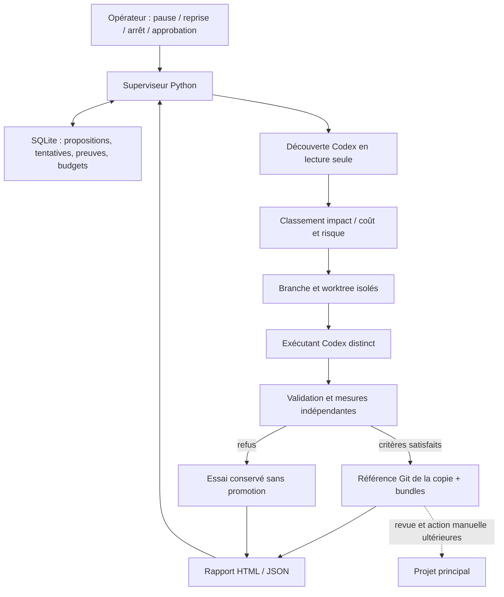

# Étude et choix d'architecture — 10 octobre 2026

Sources primaires consultées : [Ralph de Geoffrey Huntley](https://ghuntley.com/ralph/), [Ralph de snarktank](https://github.com/snarktank/ralph), [script inspectable](https://github.com/snarktank/ralph/blob/main/ralph.sh), [Codex SDK officiel](https://learn.chatgpt.com/docs/codex-sdk), [mode non interactif](https://learn.chatgpt.com/docs/non-interactive-mode), [sandbox Windows](https://learn.chatgpt.com/docs/windows/windows-sandbox). Le comportement local de Codex CLI 0.160.0 a aussi été vérifié avec `--version` et `exec --help`.

| Solution | Intérêt pour ce projet | Écart avec le besoin | Décision |
|---|---|---|---|
| Reprise existante toutes les 5 h | Déjà installée, mutex, logs, modèle/configuration existants | Écrit dans le principal, pas de validation indépendante, historique narratif, budget et promotion non contrôlés | Conserver sans modification durant le prototype ; transition ultérieure explicite |
| Ralph, implémentation snarktank | Petites tâches, contexte frais, mémoire Git/progrès, tests par itération | Script Bash orienté Amp/Claude, arrêt lorsque le PRD est terminé ; pas un superviseur Windows avec budget mesuré et découverte permanente | Reprendre les principes ; ne pas installer son script ni ses dépendances |
| Codex SDK TypeScript officiel | Threads locaux, reprise par identifiant, transport structuré ; Node présent | Package absent ici ; gestion d'approbations complexes à vérifier ; ne fournit pas à lui seul politique de validation, Git ou plafond de coût | Exemple d'adaptateur fourni ; installation et intégration différées |
| Codex SDK Python officiel | App-server JSON-RPC ; cohérent avec un superviseur Python | Package absent ; la documentation indique un runtime épinglé, à comparer au CLI installé ; nouvelle dépendance et tests nécessaires | Alternative à évaluer au cycle d'intégration, sans installation globale |
| Codex CLI `exec --json` | Déjà installé et authentification existante réutilisable ; événements et schéma de sortie | Contrôle moins riche que l'app-server ; usage fourni en fin de tour ; certaines restrictions locales actuelles | Transport de prototype implémenté derrière une interface, désactivé par défaut |
| App-server Codex | Adapté à des clients personnalisés avec approbations et événements | Plus de protocole à maintenir pour un premier prototype | Étape possible si approbations interactives et contrôle distant deviennent nécessaires |

Le motif Ralph est une boucle d'itérations courtes alimentée par des preuves persistantes. L'implémentation snarktank termine lorsque ses items passent. Le besoin de Token Radar ajoute donc une étape indépendante de découverte/mesure après épuisement du backlog, avec abstention lorsque rien d'utile n'est démontré. Cela n'exige pas de relancer une session infinie ou de lui demander de décider elle-même de sa réussite.

## Architecture retenue

Le superviseur garde la politique, les contrats, le budget et l'historique en dehors du worktree. Il ne délègue pas le verdict d'acceptation à l'agent. Les sessions de découverte et d'implémentation peuvent repartir d'un contexte frais ; la mémoire importante est structurée dans SQLite/Git. Le dernier identifiant de thread est mémorisé lorsqu'il est fourni, sans rejouer automatiquement un appel interrompu.

Le prototype fonctionne sans PostgreSQL/Redis, Docker, WSL, serveur public, clé API supplémentaire ou SDK à installer. La compatibilité Windows est testée avec vrais Git worktrees, SQLite, processus et Job Objects. Il ne répare pas les services de Token Radar et n'élargit pas les permissions de cette session.

## Ce que la première version ne démontre pas

La démo prouve la mécanique, pas la qualité d'un choix de modèle, d'une proposition IA ou d'une amélioration financière de Token Radar. L'acceptation implémentée exige une métrique numérique positive à minimiser ; il faudra ajouter des contrats explicites pour une correction fonctionnelle sans objectif de vitesse, des métriques multiples et des cohortes live. Les tests de référence ne peuvent pas être modifiés par l'exécutant ; les évolutions du contrat exigent une revue distincte.

La séparation Git et les exclusions empêchent des écritures accidentelles courantes, mais ne sécurisent pas l'exécution d'un code généré hostile. Cette dernière exige une isolation OS vérifiée avant activation live. Les appels/tokens/temps sont suivis, mais aucune conversion fiable en euros ni plafond financier absolu n'est prétendu pour l'abonnement Codex actuel.
